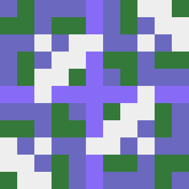
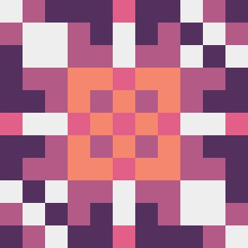

# Pixicon

### Identicon / Hashicon generator

An experimental hashicon generator. Designed to produce highly identifable
icons with as many different results as possible. It is a WIP, still
looking into better pattern/color generation methods and different shapes.
The code is also a bit unoptimized and longer than it could be.

